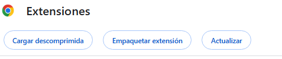
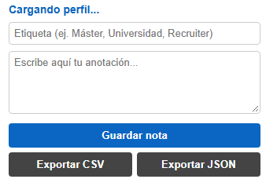

# Mis Notas LinkedIn

Extensión minimalista para Google Chrome (Manifest V3) que permite añadir etiquetas y notas privadas directamente sobre cualquier perfil de LinkedIn y exportar toda tu base de datos local a **CSV** o **JSON**.

## Características
* **Privacidad total:** Todos los datos se guardan exclusivamente en el almacenamiento local de tu navegador (`chrome.storage.local`), sin servidores externos.
* **Detección automática:** Extrae automáticamente el nombre, titular/cargo y URL limpia del perfil que estás visitando.
* **Edición sin duplicados:** Si vuelves a entrar en un perfil ya anotado, carga tu nota anterior para editarla o actualizarla.
* **Exportación en 1 clic:** Descarga todos los contactos anotados en formato **JSON** o **CSV** (codificado en UTF-8 con BOM y separado por `;` para abrirlo directamente en Excel).

---

## Instalación en Chrome
1. Descarga este repositorio (botón verde **Code** > **Download ZIP** y descomprímelo) o clónalo con Git.
2. Abre `chrome://extensions/` en Google Chrome.
3. Activa el **Modo de desarrollador** en la esquina superior derecha.
4. Pulsa **Cargar descomprimida** y selecciona la carpeta del proyecto.

---

## Cómo usarla
1. Entra en el perfil de cualquier contacto en LinkedIn (`https://www.linkedin.com/in/...`).
2. Haz clic en el icono de **Mis Notas LinkedIn** en la barra de extensiones de Chrome.
3. Escribe una **etiqueta** (ej. *Universidad*, *Máster*, *Recruiter*) y tu **anotación**, y pulsa **Guardar nota**.
4. Cuando quieras extraer tus datos, pulsa **Exportar CSV** o **Exportar JSON**.

---

## Estructura de los datos exportados
Cada contacto guardado incluye los siguientes campos:
* `nombre`: Nombre completo del perfil.
* `cargo`: Titular profesional visible en LinkedIn.
* `etiqueta`: Categoría o grupo asignado.
* `nota`: Texto libre con tus anotaciones.
* `url`: Enlace limpio al perfil (`https://www.linkedin.com/in/usuario`).
* `fechaGuardado`: Fecha de creación o última edición (`AAAA-MM-DD`).